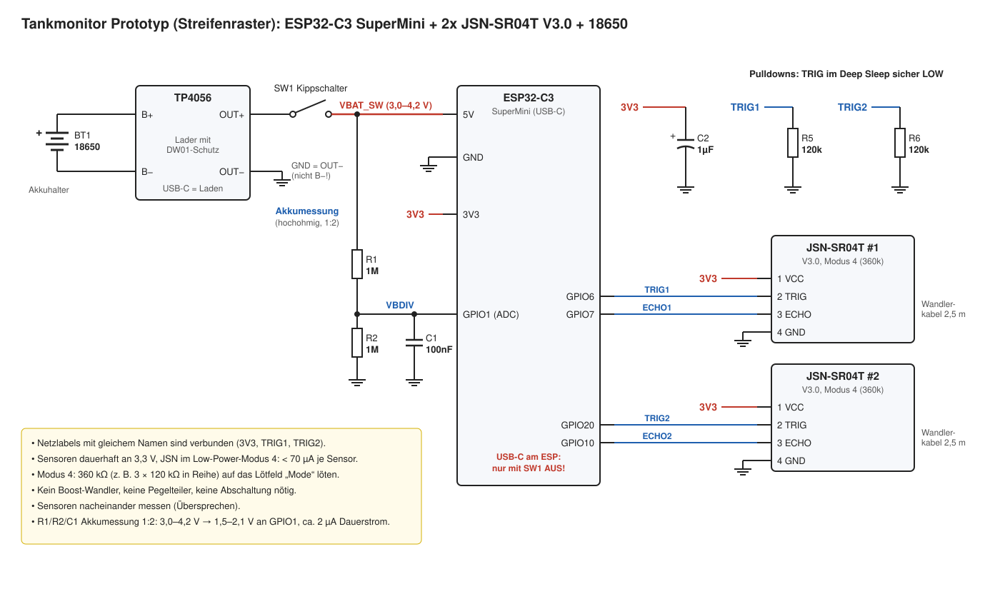
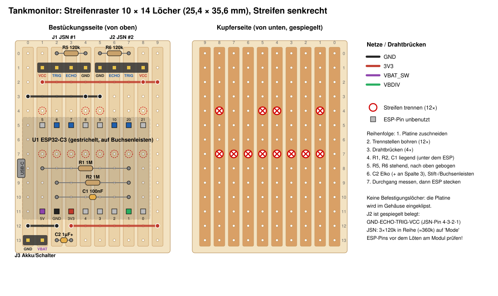

# Tankmonitor Prototyp: Streifenraster + 3D-Druck-Gehäuse

ESP32-C3 SuperMini, 2× JSN-SR04T V3.0, 18650 mit TP4056-Lader. Misst stündlich und sendet per MQTT.

`firmware/` ESPHome ([Anleitung](firmware/README.md)) · `docs/` Schaltplan und Streifenraster (Generatoren) · `case/` Gehäuse (SolidCraft, STL) · `datasheets/`

## Schaltung

- Die Sensoren hängen dauerhaft an 3V3 und laufen im **Low-Power-Modus 4**: Ruhestrom < 70 µA je Sensor. Eine Abschaltung ist dadurch nicht nötig.
- **Modus 4:** 360 kΩ (3 × 120k in Reihe) auf das Lötfeld „Mode“ der JSN-Platine löten. M1/M2 bleiben offen. Laut Datenblatt hat Modus 4 keinen Watchdog: Hängt ein Sensor, hilft nur Kippschalter aus und wieder ein.
- R5/R6 halten TRIG im Deep Sleep auf LOW.
- R1/R2/C1 messen die Akkuspannung (1:2 an GPIO1, ca. 2 µA).
- Pins: TRIG1/ECHO1 = GPIO6/7, TRIG2/ECHO2 = GPIO20/10, Akku = GPIO1.
- Laufzeit: ca. 0,35 mA im Mittel, also ca. **10 Monate** pro 18650.

## Teile

| Teil | Wert |
|---|---|
| TP4056 USB-C-Modul mit Schutz (IN±, B±, OUT±) | – |
| R1, R2 | 1 MΩ |
| R5, R6 | 120 kΩ |
| Mode-Widerstand je Sensor | 3 × 120 kΩ in Reihe |
| C1 | 100 nF |
| C2 | Elko 1 µF (besser 10–47 µF, Ø ≤ 5 mm), + an Spalte 3 |
| Streifenraster | 10 × 14 Löcher |
| Buchsenleiste 1×8 (2×), Stiftleiste 1×4 (2×) und 1×2 | – |
| Dupont-Kabel Buchse–Buchse | 8 |
| Gewindeeinsätze + Schrauben | M2 (8×, JSN), M3 (4×, Deckel) |

## Aufbau Streifenraster

Koordinaten (Spalte, Zeile) ab oben links, Bestückungsseite. Die Streifen laufen senkrecht. Spalte 0 = GND, Spalte 9 = 3V3.

1. 10 × 14 Löcher zuschneiden (25,4 × 35,6 mm).
2. 12 Trennstellen bohren: Zeile 4 in den Spalten 1, 4, 5, 8 und Zeile 7 in den Spalten 1–8.
3. 4 Drahtbrücken:
   - Zeile 2: 3V3, verlötet an Spalte 1, 8, 9
   - Zeile 3: GND, verlötet an Spalte 0, 4, 5
   - Zeile 12: GND 0→2 und 3V3 3→9
4. Liegend unter dem ESP: R1 (1,8)–(7,8), R2 (2,9)–(7,9), C1 (2,10)–(7,10).
5. R5 (2,0)–(4,0) und R6 (5,0)–(7,0) stehend, nach außen gebogen. C2 (2,13)–(3,13).
6. Stecker und Leisten:
   - J1/J2 in Zeile 1
   - J3 (GND, VBAT) bei (0,13)/(1,13)
   - Buchsenleisten für den ESP in Zeile 5 und 11, Spalten 1–8, USB-C links
7. Mit dem Multimeter prüfen: zwischen 3V3, GND und VBAT_SW darf kein Kurzschluss sein. Erst dann den ESP stecken.

J2 ist gespiegelt belegt (GND, ECHO, TRIG, VCC). Pinbelegung und Reihenabstand (15,24 mm) des SuperMini vor dem Löten am eigenen Modul prüfen.

**Externe Verdrahtung:**
- Akku → TP4056 B+/B−
- OUT+ → Kippschalter → J3 VBAT
- **OUT− → J3 GND** (nicht B−)

## Gehäuse

`python case/gen_case.py` erzeugt per SolidCraft-CLI das Design (`.solidcraft`), STL für Unterteil und Deckel sowie Vorschaubilder.

- Die Platine wird eingeklipst: links unter die zwei Leisten schieben, rechts herunterdrücken, bis die Rastzungen einschnappen.
- Durchbrüche:
  - links: USB-C des ESP
  - rechts: USB-C des TP4056
  - vorne: Schalter Ø 20,2 mm
  - Stirnseiten: Kabelschlitze
- Vor dem Druck nachmessen und in `gen_case.py` eintragen: TP4056 (`TP_*`), Akkuhalter (`BAT_*`), Schalter (`SW_*`), Einschmelzmuttern (`*_PILOT`), ESP-Höhe (`ESP_*`).

## Wichtig

- **USB am ESP nur mit Kippschalter AUS**, sonst geht USB-5V auf den Akku. Geladen wird über den TP4056.
- Sensor mindestens 25 cm über dem höchsten Füllstand montieren (Blindzone 21 cm).
- Für Heizöl geeignet. Nicht in Ex-Zonen (Benzin, Gas) verwenden.
