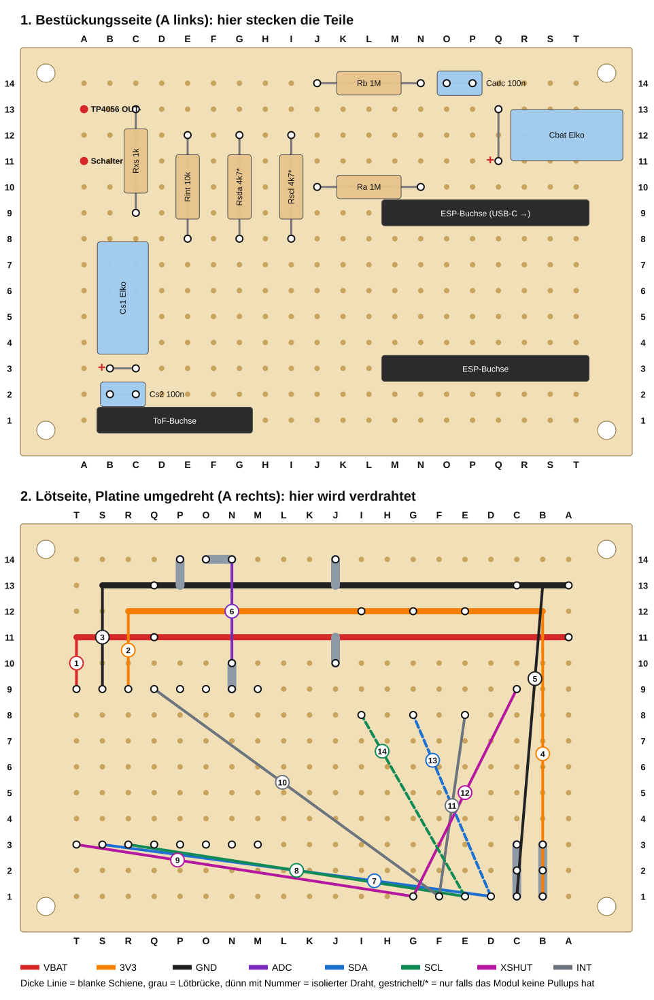

# Lötanleitung für Einsteiger (1 Platine pro Tank)

Jedes Bauteil hat hier ein festes Loch. Schaltung und Begründungen: [schaltung.md](schaltung.md).

Anschlüsse und Netze wurden rechnerisch mit dem Schaltplan abgeglichen, die Platzierung auf Überschneidungen geprüft (`gen_loetplan.py`, mit angenommenen Bauteilmassen). **Noch nie real aufgebaut.** Lege vor dem Löten alle Teile probeweise auf die Platine.

## Material (pro Platine)

| Name | Teil | Von Loch | Nach Loch |
|---|---|---|---|
| – | Buchsenleiste 1×6 (ToF) | B1 | G1 |
| – | Buchsenleiste 1×8 (ESP) | M3 | T3 |
| – | Buchsenleiste 1×8 (ESP) | M9 | T9 |
| `Cs2` | Kondensator 100 nF | B2 | C2 |
| `Cs1` | Elko 10–47 µF, liegend Richtung Reihe 8 | **B3 (+)** | C3 (−) |
| `Rxs` | 1 kΩ | C9 | C13 |
| `Rint` | 10 kΩ | E8 | E12 |
| `Rsda` | 4,7 kΩ (nur falls nötig) | G8 | G12 |
| `Rscl` | 4,7 kΩ (nur falls nötig) | I8 | I12 |
| `Ra` | 1 MΩ | J10 | N10 |
| `Rb` | 1 MΩ | J14 | N14 |
| `Cadc` | Kondensator 100 nF | O14 | P14 |
| `Cbat` | Elko 10–47 µF, liegend Richtung Spalte T | **Q11 (+)** | Q13 (−) |

Dazu: Punktraster 60 × 40 mm, blanker Draht für drei Schienen (ca. 20 cm), dünne isolierte Litze oder Schaltdraht (ca. 60 cm).

Widerstände vorher mit dem Multimeter messen, die Farbringe verwechselt man leicht. Elkos haben eine Richtung: Der **Streifen** auf dem Gehäuse ist Minus.

## Werkzeug und Grundtechnik

Lötkolben mit Temperaturregelung (ca. 320–350 °C), Lötzinn mit Flussmittelseele (0,5–0,8 mm), Seitenschneider, Abisolierzange, Entlötlitze, Multimeter, dritte Hand oder Klebeband. Lüften, Hände nach dem Löten waschen.

So entsteht eine gute Lötstelle:
1. Spitze reinigen und mit etwas Zinn benetzen.
2. Spitze **gleichzeitig** an Lötauge und Draht halten, ca. 1 s.
3. Zinn an die Stelle führen (nicht an die Spitze), bis es um den Draht fliesst.
4. Erst Zinn weg, dann Kolben weg. Nicht bewegen, bis es erstarrt ist.

Gut: glänzender oder gleichmässig matter kleiner Kegel. Schlecht: Kugel, die nur auf dem Draht sitzt (zu kalt), oder Zinn, das ins Nachbarauge reicht. Dauert es länger als ca. 4 s: abkühlen lassen und neu versuchen.

**Ohne Erfahrung zuerst auf einem Reststück üben:** 20 Lötpunkte, eine Lötbrücke zwischen zwei Löchern, einen Draht anlöten und wieder entlöten.

## Vorbereitung

- [ ] Auf beiden Seiten mit feinem Filzstift die Spalten **A–T** und Reihen **1–14** am Rand beschriften. Auf der Bestückungsseite ist A links, auf der Lötseite A **rechts**. Reihe 1 bleibt unten.
- [ ] Die Platine hat 20 × 14 Löcher. Loch T sitzt 5,5 mm von der Plattenkante (siehe [schaltung.md](schaltung.md)): so herum beschriften.
- [ ] Am ToF-Modul den Aufdruck lesen. Erwartet: VIN, GND, **SDA, SCL**, INT, XSHUT. Manche Module haben **SCL vor SDA**. Dann Draht 7 nach **E1** und Draht 8 nach **D1** führen, ebenso Draht 13 von E1 und Draht 14 von D1.
- [ ] Pullups prüfen: am losen Modul Widerstand SDA–VIN und SCL–VIN messen. Ca. 4,7–10 kΩ: `Rsda`, `Rscl` und die Drähte 13 und 14 **weglassen**.

## Schritt 1: Buchsenleisten und Modulstifte

- [ ] Stiftleisten an den ESP löten (Stifte zeigen von der USB-C-Seite weg).
- [ ] Stiftleiste am ToF-Modul: von der **Sensorseite** einstecken (Kunststoff auf der Sensorseite), auf der Rückseite verlöten.
- [ ] Buchsenleisten auf die Bestückungsseite stecken, ESP und Modul aufstecken, damit alles gerade steht.
- [ ] Je Leiste **nur einen** Eckpin löten, Sitz prüfen (flach, senkrecht), nachwärmen falls schief. Dann alle Pins löten.
- [ ] ESP und Modul wieder **abziehen**.

## Schritt 2: Bauteile

Teil von der Bestückungsseite einstecken, flach anlegen, Beine auf der Lötseite leicht spreizen, löten. Überstand erst abschneiden, wenn die Brücke oder der Draht an diesem Loch fertig ist, oder ca. 2 mm stehen lassen. Reihenfolge: flach vor hoch.

- [ ] Widerstände `Rxs`, `Rint`, `Ra`, `Rb` (und `Rsda`, `Rscl`, falls nötig)
- [ ] Kondensatoren `Cs2`, `Cadc`
- [ ] Elkos `Cs1`, `Cbat`: Beine vorher um 90° biegen, **Plus** wie in der Tabelle

## Schritt 3: Schienen (Lötseite, blanker Draht)

Draht gerade ziehen, an den Enden und an jedem **benutzten** Loch anlöten. Er darf keine anderen Lötpunkte berühren.

| Schiene | Reihe | Von – bis | Dort anlöten |
|---|---|---|---|
| VBAT | 11 | A11 – T11 | A11, J11, Q11, T11 |
| 3V3 | 12 | B12 – R12 | B12, E12, G12, I12, R12 |
| GND | 13 | A13 – S13 | A13, B13, C13, J13, P13, Q13, S13 |

**A11 und A13 noch nicht löten:** Schiene nur darüberlegen. Dort kommen in Schritt 7 die externen Drähte hin.

## Schritt 4: Lötbrücken (Lötseite)

Jeweils zwei **direkt benachbarte** Löcher verbinden, am einfachsten mit dem abgeschnittenen Bauteilbein.

- [ ] B1–B2, B2–B3
- [ ] C1–C2, C2–C3
- [ ] J10–J11
- [ ] J13–J14
- [ ] N9–N10 (**nicht** bis N11, dort liegt VBAT)
- [ ] N14–O14
- [ ] P13–P14

## Schritt 5: Isolierte Drähte (Lötseite)

An jedem Ende nur ca. 2 mm abisolieren und auf den vorhandenen Lötpunkt (Buchsenpin, Bauteilbein oder Schiene) auflöten. Drähte flach führen (unter dem Deckel sind knapp 4 mm Platz), sie dürfen sich kreuzen. Nach jedem Draht abhaken.

| Nr. | Von | Nach | Signal |
|---|---|---|---|
| 1 ☐ | T9 | T11 | VBAT |
| 2 ☐ | R9 | R12 | 3V3 |
| 3 ☐ | S9 | S13 | GND |
| 4 ☐ | B1 | B12 | 3V3 |
| 5 ☐ | C1 | B13 | GND |
| 6 ☐ | N10 | N14 | Akkumessung |
| 7 ☐ | S3 | D1 | SDA |
| 8 ☐ | R3 | E1 | SCL |
| 9 ☐ | T3 | G1 | XSHUT |
| 10 ☐ | Q9 | F1 | INT |
| 11 ☐ | F1 | E8 | INT |
| 12 ☐ | G1 | C9 | XSHUT |
| 13 ☐ | D1 | G8 | SDA (nur mit `Rsda`) |
| 14 ☐ | E1 | I8 | SCL (nur mit `Rscl`) |

An D1, E1, F1 und G1 treffen sich zwei Drähte an einem Lötpunkt.

## Schritt 6: Prüfen (ohne ESP, Modul und Akku)

Mit Lupe und Licht: Zinnbrücken zwischen Nachbarlöchern, die nicht oben stehen, entfernen. Besonders B↔C (Reihen 1–3) und die Reihen 10–14.

Durchgang (Multimeter piept):

| Netz | Alle miteinander verbunden |
|---|---|
| 3V3 | R9, B1, B3 |
| GND | S9, C1, C3, A13 |
| VBAT | T9, A11 |
| Signale | S3–D1, R3–E1 (bei getauschten Modulpins S3–E1, R3–D1), T3–G1, Q9–F1 |

Widerstand:

| Messpunkte | Erwartet |
|---|---|
| 3V3 (R9) – GND (S9) | kein Kurzschluss (Wert steigt, weil die Elkos laden) |
| VBAT (T9) – GND (S9) | ca. 2 MΩ (Anzeige wandert anfangs) |
| VBAT (T9) – 3V3 (R9) | offen bzw. sehr hochohmig |
| T9 – N9 und N9 – S9 | je ca. 1 MΩ |
| G1 – S9 | ca. 1 kΩ |
| F1 – R9 | ca. 10 kΩ |
| D1 – R9 und E1 – R9 | ca. 4,7 kΩ, falls `Rsda`/`Rscl` bestückt |

## Schritt 7: Akku, Lader, Schalter

**Die 18650-Zelle bleibt beim Löten draussen.** Nie direkt an die Zelle löten, nur den Halter verwenden.

- [ ] Zuerst prüfen, ob der Schalter von aussen in die Gehäusewand muss: dann vor dem Anlöten einsetzen.
- [ ] Halter **+** → TP4056 **B+**, Halter **−** → TP4056 **B−**
- [ ] TP4056 **OUT+** → Schalter, Schalter → **A11**
- [ ] TP4056 **OUT−** → **A13** (nicht B−)
- [ ] Drähte zur Platine ca. 5–8 cm, blanke Stellen am Schalter isolieren (Schrumpfschlauch)
- [ ] Mit Durchgangsprüfung kontrollieren, dass der Plus-Kontakt des Halters wirklich an B+ liegt. Eine falsch herum angeschlossene Zelle kann den Lader zerstören.

## Schritt 8: Erster Test

1. Schalter **AUS**, Zelle richtig herum einlegen.
2. Schalter EIN, **ohne** ESP und Modul: T9–S9 zeigt die Akkuspannung (ca. 3,0–4,2 V), N9–S9 etwa die Hälfte (wegen des Messgeräts etwas weniger).
3. Wird etwas warm oder riecht es: sofort Zelle entnehmen und Fehler suchen.
4. Schalter AUS. ESP **einzeln** per USB flashen ([Firmware](../firmware/README.md)).
5. ESP aufstecken (USB-C Richtung Spalte T, Bauteilseite von der Platine weg), Modul aufstecken (Sensor von der Platine weg, Modul liegt über den Reihen 2–4).
6. Schalter EIN, Werte in Home Assistant prüfen.

**USB am ESP nur mit Schalter AUS.** Geladen wird über den TP4056.
